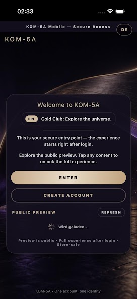
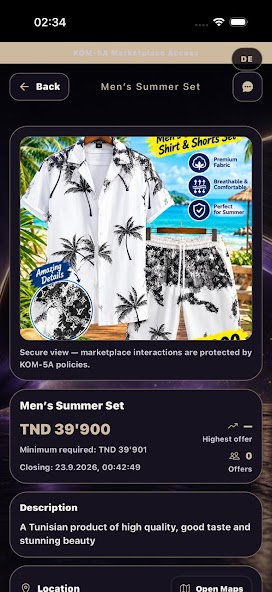
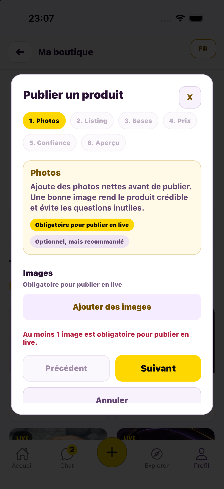

# Découvrir KOM-5A / Product tour

[Français](../README.fr.md) · [English](../README.md) · [Partenariats / Partnerships](partners.md)

[Voir le parcours Web du 19 novembre 2026 — 65 s / Watch the 19 November 2026 web walkthrough — 65 s](demo.md)

## Commencer par l'accueil / Start with the welcome page

[Découvrir KOM-5A sur le Web / Discover KOM-5A on the web](https://kom-5a.com/?utm_source=github&utm_medium=referral&utm_campaign=product_tour)

L'accueil public présente la plateforme et donne accès à la découverte, à l'inscription et aux applications officielles. Pour retrouver l'expérience mobile, choisissez [iOS](https://apps.apple.com/ch/app/kom-5a/id6756894425) ou [Android](https://play.google.com/store/apps/details?id=com.kom5a.mobile). Les conditions de disponibilité et de compatibilité sont celles de la boutique et du service.

The public welcome page introduces the platform and links to discovery, sign-up and the official mobile apps. Choose [iOS](https://apps.apple.com/ch/app/kom-5a/id6756894425) or [Android](https://play.google.com/store/apps/details?id=com.kom5a.mobile) for the mobile experience. Availability and compatibility depend on the store and service conditions.

## Le parcours / The journey

### Dans l'application / In the app

<table>
  <tr>
    <td align="center"></td>
    <td align="center"></td>
  </tr>
  <tr>
    <td><strong>Accueil mobile / Mobile welcome</strong> Écran d'entrée avant connexion ; l'aperçu public y est en chargement.</td>
    <td><strong>Consulter une publication / View a listing</strong> Exemple historique de fiche produit. Les prix, dates, modalités et textes de l'annonce appartiennent à cette image ; ils ne constituent pas une offre actuelle ni une validation de ses affirmations.</td>
  </tr>
</table>

Ces visuels sont diffusés sur la [fiche Google Play officielle](https://play.google.com/store/apps/details?id=com.kom5a.mobile), consultée le **19 novembre 2026**. La date et la version de leur capture d'origine ne sont pas établies ; ils ne prouvent pas un parcours exécuté aujourd'hui. [Sources des images](../media/store/SOURCES.md).

These images appear on the [official Google Play listing](https://play.google.com/store/apps/details?id=com.kom5a.mobile), reviewed on **19 November 2026**. Their original capture date and build are not established. They are historical interface illustrations, not evidence of a workflow completed today or an offer currently available. [Image sources](../media/store/SOURCES.md).

### De la publication au contact / From publishing to contact

| Étape / Step | Ce que fait l'utilisateur / User action |
| --- | --- |
| 1. Présenter / Present | Le créateur prépare une publication avec ses images, sa description et les détails de son offre, selon les options de son compte. / A creator prepares images, a description and offer details using the options available to the account. |
| 2. Découvrir / Discover | Le visiteur parcourt les publications et ouvre celles qui l'intéressent. / A visitor browses publications and opens those that are relevant. |
| 3. Comprendre / Understand | Il consulte les détails et le profil du créateur avant de décider de la suite. / The visitor reads the details and creator profile before deciding what to do next. |
| 4. Échanger / Connect | Il utilise un moyen de contact proposé pour poser une question. / The visitor uses an available contact option to ask a question. |

Ce parcours décrit les fonctions du produit. Il ne représente pas un témoignage client, une vente démontrée ou une garantie de contact. Les auteurs restent responsables de leurs offres ; consultez les [informations officielles](https://kom-5a.com/about) et les conditions applicables.

This journey describes product functions. It is not a customer testimonial, evidence of a completed sale or a guarantee of an enquiry. Publishers remain responsible for their offers; see the [official overview](https://kom-5a.com/about) and applicable terms.

## Préparer une publication / Prepare a publication

Capture originale du **7 novembre 2026** : un formulaire vide à l'étape Photos affiche la validation nécessaire avant publication. Elle illustre le parcours de préparation à cette date. Les écrans actuels peuvent évoluer.

Original screenshot from **7 November 2026**: the empty Photos step shows validation before publishing. It illustrates preparation at that time; current screens may differ.

[Lire le guide de publication / Read the listing guide](listing-guide.md) · [Voir les captures claires et sombres / Browse light and dark screenshots](../media/README.md)

## Voir une démonstration ciblée / Request a focused demonstration

Pour évaluer un cas d'usage professionnel, [contactez KOM-5A](https://kom-5a.com/contact) en précisant le type d'offre, le pays et le parcours que vous souhaitez examiner. Une démonstration doit utiliser des contenus autorisés et des données adaptées au partage.

To review a professional use case, [contact KOM-5A](https://kom-5a.com/contact) with the type of offer, country and workflow you want to examine. A demonstration should use authorised content and information suitable for sharing.

Sources publiques relues le **19 novembre 2026** : [accueil](https://kom-5a.com/), [présentation](https://kom-5a.com/about), [conditions des services](https://kom-5a.com/service-terms?lang=en). Les captures fournies sont datées individuellement ; la date de capture d'origine des visuels de boutique n'est pas établie. Aucun indicateur commercial n'est déduit de ces images.
