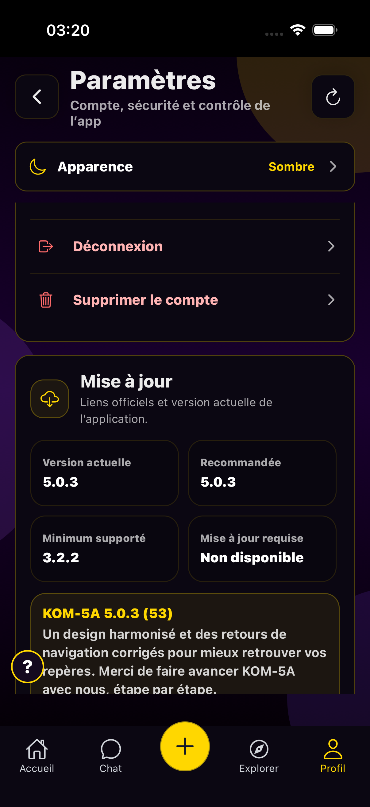
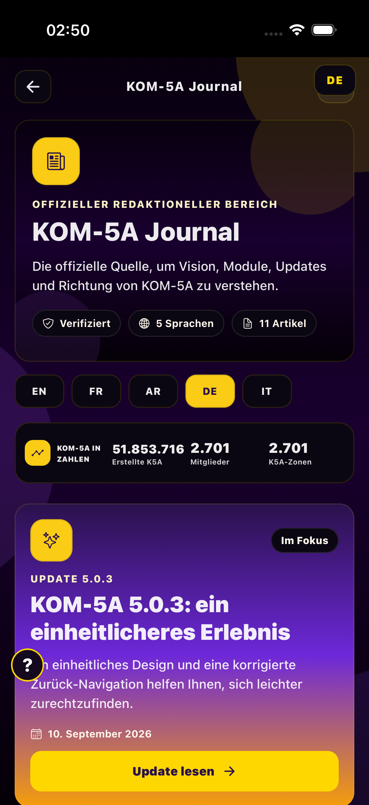

# Visuels KOM-5A / KOM-5A media

[Français](../README.fr.md) · [English](../README.md) · [Textes FR/EN](press-kit.md) · [Applications](../docs/apps.md)

Des images pour présenter la plateforme, avec leur contexte. Ces fichiers ont été fournis par KOM-5A et relus pour cette publication le **19 novembre 2026**. Les captures ci-dessous datent du **8 novembre 2026**, selon les noms des fichiers fournis. Elles illustrent cette version de l'interface ; les écrans et conditions actuels peuvent évoluer.

Images for introducing the platform, with context. The supplied screenshots are dated **8 November 2026** by their original filenames and were reviewed for this publication on **19 November 2026**. They illustrate that interface at that time; current screens and conditions may differ.

## Bannière / Banner

[Télécharger le SVG / Download SVG](../assets/cover.svg). Illustration de présentation, distincte d'une capture de l'application. Format : 1280 × 480.

## Captures de l'application / App screenshots

<table>
  <tr>
    <td align="center"></td>
    <td align="center"></td>
  </tr>
  <tr>
    <td><strong>Paramètres / Settings</strong> Apparence et options du compte. La version 5.0.3 visible appartient à cette capture ; consulter les boutiques pour la version proposée aujourd'hui.</td>
    <td><strong>Configuration de sécurité / Security setup</strong> Choix de configuration du verrouillage de l'application. L'écran précise que la protection reste inactive tant qu'elle n'est pas activée. Cette image n'établit ni son activation sur un compte, ni un audit ou une certification.</td>
  </tr>
</table>

- [Paramètres, PNG 1206 × 2622](screens/settings-fr-2026-11-08.png)
- [Configuration de sécurité, PNG 1206 × 2622](screens/app-lock-fr-2026-11-08.png)

The settings screenshot shows a historical version number. The security setup screenshot describes an optional setup flow; it does not demonstrate that App Lock is enabled, or establish a security audit or certification.

### Journal — archive d'interface / Journal — interface archive

[Télécharger le PNG 1206 × 2622 / Download PNG](screens/journal-de-2026-11-08.png)

Exemple historique du Journal en allemand. Les compteurs, la date de l'article et le numéro de version visibles sont ceux de l'image ; **ne pas les citer comme des chiffres actuels**. Cette capture sert à illustrer l'interface éditoriale et la sélection de langues.

Historical German Journal interface. Visible counters, article date and version belong to the image and **must not be quoted as current figures**. Use it to illustrate the editorial interface and language selection.

## Portrait fourni / Supplied portrait

[Télécharger le portrait, JPEG 1125 × 1126 / Download portrait](portraits/portrait-provided.jpg)

Portrait fourni pour la communication de KOM-5A. Ce fichier ne vaut pas confirmation d'identité : demander une légende nominative confirmée à KOM-5A avant de nommer la personne. Les métadonnées de provenance non nécessaires ont été retirées sans modifier les données de l'image.

Portrait supplied for KOM-5A communication. Confirm a named caption with KOM-5A before identifying the person. Unnecessary provenance metadata was removed without changing the compressed image data.

## Utilisation et contact / Use and contact

Conservez le contexte et la date des captures. N'utilisez pas ces images pour annoncer un bonus, un nombre actuel de membres, une garantie commerciale ou une certification de sécurité. Les textes de présentation disponibles dans le [kit FR/EN](press-kit.md) renvoient aux informations officielles.

Keep screenshot dates and context with the images. This collection does not grant a general licence to reuse KOM-5A branding, portraits or third-party material. For a publication, partnership or usage request, use the [official contact page](https://kom-5a.com/contact).

