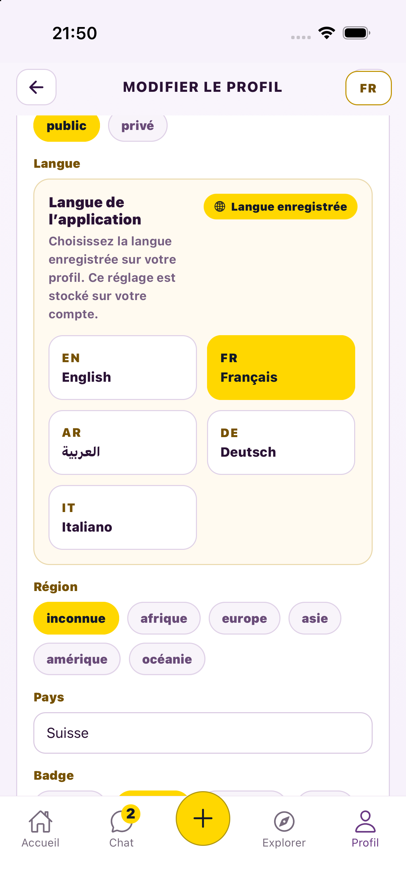
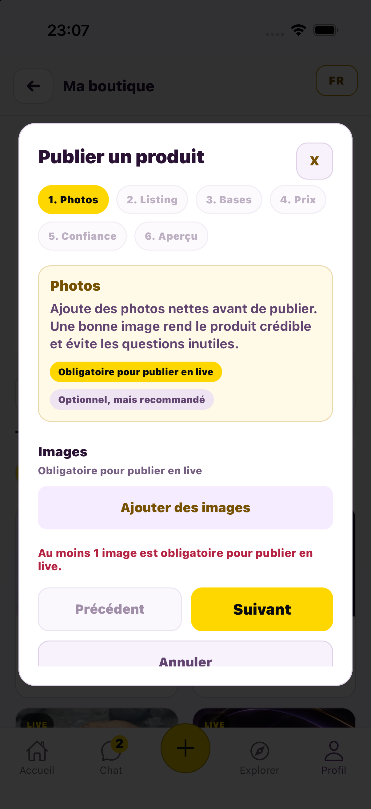
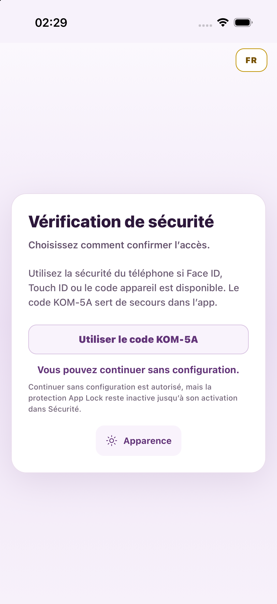
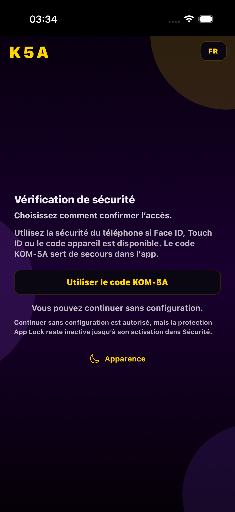

# Visuels KOM-5A / KOM-5A media

[Français](../README.fr.md) · [English](../README.md) · [Textes FR/EN](press-kit.md) · [Applications](../docs/apps.md)

Pour diffuser ces ressources : [liens de partage, aperçu et annonce FR/EN](share-guide.md).

Des images pour présenter la plateforme et son application en **mode clair et en mode sombre**, avec leur contexte. Les captures iPhone fournies par KOM-5A datent du **2 au 8 novembre 2026**, selon les noms des fichiers ; chaque légende précise sa date. Les visuels issus de la fiche Google Play sont identifiés séparément et leur date de capture d'origine n'est pas établie. Relecture pour cette publication : **19 novembre 2026**. Les écrans et conditions actuels peuvent évoluer.

Images for introducing the platform and app in **light and dark mode**, with context. Supplied iPhone screenshots are dated **2–8 November 2026** by their original filenames, with individual dates in the captions. Official store images are identified separately; their original capture date is unknown. Reviewed for this publication on **19 November 2026**. Current screens and conditions may differ.

## Bannière / Banner

[Télécharger le SVG / Download SVG](../assets/cover.svg). Illustration de présentation, distincte d'une capture de l'application. Format : 1280 × 480.

## Captures de l'application / App screenshots

### Accueil et fiche produit / Welcome and listing

<table>
  <tr>
    <td align="center"></td>
    <td align="center"></td>
  </tr>
  <tr>
    <td><strong>Accueil mobile / Mobile welcome</strong> Écran d'entrée avant connexion ; aperçu public en chargement.</td>
    <td><strong>Consultation / Listing detail</strong> Exemple historique : prix, échéance et textes de l'annonce ne constituent pas une offre actuelle ou une preuve de vente.</td>
  </tr>
</table>

Visuels de la [fiche Google Play officielle](https://play.google.com/store/apps/details?id=com.kom5a.mobile), consultée le **19 novembre 2026** ; date de capture et version d'origine non établies. Official store images reviewed on **19 November 2026**, with original capture date and build unknown. [Sources et contexte / Sources and context](store/SOURCES.md) · [Parcours produit / Product tour](../docs/product-tour.md).

### Mode clair / Light mode

Captures originales de l'application en mode clair. Les fichiers n'ont pas été recolorés.

Original light-mode app screenshots. These files have not been recoloured.

<table>
  <tr>
    <td align="center"></td>
    <td align="center"></td>
    <td align="center"></td>
  </tr>
  <tr>
    <td><strong>Langues / Languages</strong> 6 novembre 2026. Écran de choix de la langue de l'application dans le profil.</td>
    <td><strong>Publication / Publishing</strong> 7 novembre 2026. Formulaire vide à l'étape Photos, avec le message de validation avant publication.</td>
    <td><strong>Configuration de sécurité / Security setup</strong> 2 novembre 2026. Choix de configuration du verrouillage de l'application ; l'écran ne montre pas une protection déjà activée.</td>
  </tr>
</table>

- [Langues / Languages — PNG 1206 × 2622](screens/languages-light-fr-2026-11-06.png)
- [Publication, étape Photos / Publishing, Photos step — PNG 1206 × 2622](screens/publish-photos-light-fr-2026-11-07.png)
- [Configuration de sécurité / Security setup — PNG 1206 × 2622](screens/app-lock-light-fr-2026-11-02.png)

These dated screens illustrate language selection, the empty product-photo form with its validation message, and optional App Lock setup. The setup screen does not establish that App Lock is enabled or that the platform has been audited or certified.

### Mode sombre / Dark mode

<table>
  <tr>
    <td align="center"></td>
    <td align="center"></td>
  </tr>
  <tr>
    <td><strong>Paramètres / Settings</strong> Apparence et options du compte. La version 5.0.3 visible appartient à cette capture ; consulter les boutiques pour la version proposée aujourd'hui.</td>
    <td><strong>Configuration de sécurité / Security setup</strong> Choix de configuration du verrouillage de l'application. L'écran précise que la protection reste inactive tant qu'elle n'est pas activée. Cette image n'établit ni son activation sur un compte, ni un audit ou une certification.</td>
  </tr>
</table>

- [Paramètres, PNG 1206 × 2622](screens/settings-fr-2026-11-08.png)
- [Configuration de sécurité, PNG 1206 × 2622](screens/app-lock-fr-2026-11-08.png)

The settings screenshot shows a historical version number. The security setup screenshot describes an optional setup flow; it does not demonstrate that App Lock is enabled, or establish a security audit or certification.

### Journal — archive d'interface / Journal — interface archive

[Télécharger le PNG 1206 × 2622 / Download PNG](screens/journal-de-2026-11-08.png)

Exemple historique du Journal en allemand. Les compteurs, la date de l'article et le numéro de version visibles sont ceux de l'image ; **ne pas les citer comme des chiffres actuels**. Cette capture sert à illustrer l'interface éditoriale et la sélection de langues.

Historical German Journal interface. Visible counters, article date and version belong to the image and **must not be quoted as current figures**. Use it to illustrate the editorial interface and language selection.

## Portrait fourni / Supplied portrait

[Télécharger le portrait, JPEG 1125 × 1126 / Download portrait](portraits/portrait-provided.jpg)

Portrait fourni pour la communication de KOM-5A. Ce fichier ne vaut pas confirmation d'identité : demander une légende nominative confirmée à KOM-5A avant de nommer la personne. Les métadonnées de provenance non nécessaires ont été retirées sans modifier les données de l'image.

Portrait supplied for KOM-5A communication. Confirm a named caption with KOM-5A before identifying the person. Unnecessary provenance metadata was removed without changing the compressed image data.

## Utilisation et contact / Use and contact

Conservez le contexte et la date des captures. N'utilisez pas ces images pour annoncer un bonus, un nombre actuel de membres, une garantie commerciale ou une certification de sécurité. Les textes de présentation disponibles dans le [kit FR/EN](press-kit.md) renvoient aux informations officielles.

Keep screenshot dates and context with the images. This collection does not grant a general licence to reuse KOM-5A branding, portraits or third-party material. For a publication, partnership or usage request, use the [official contact page](https://kom-5a.com/contact).

